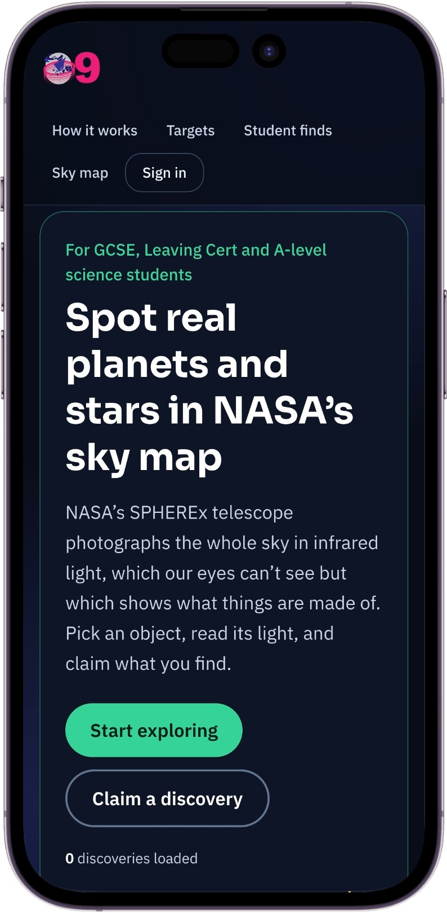
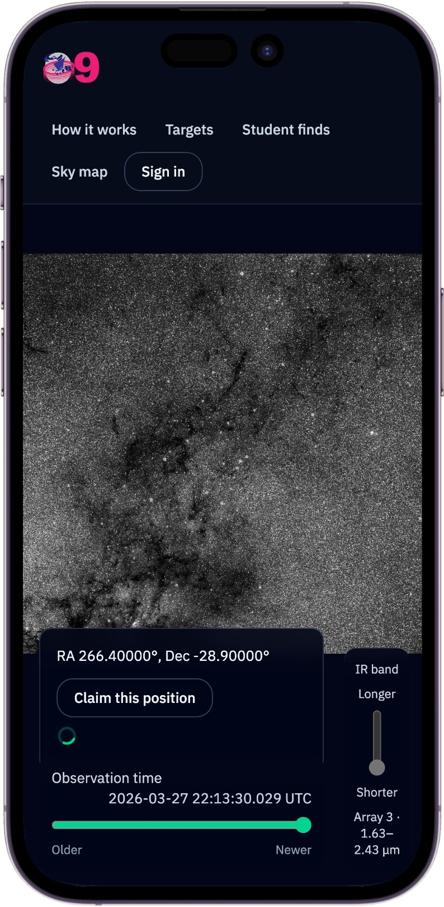
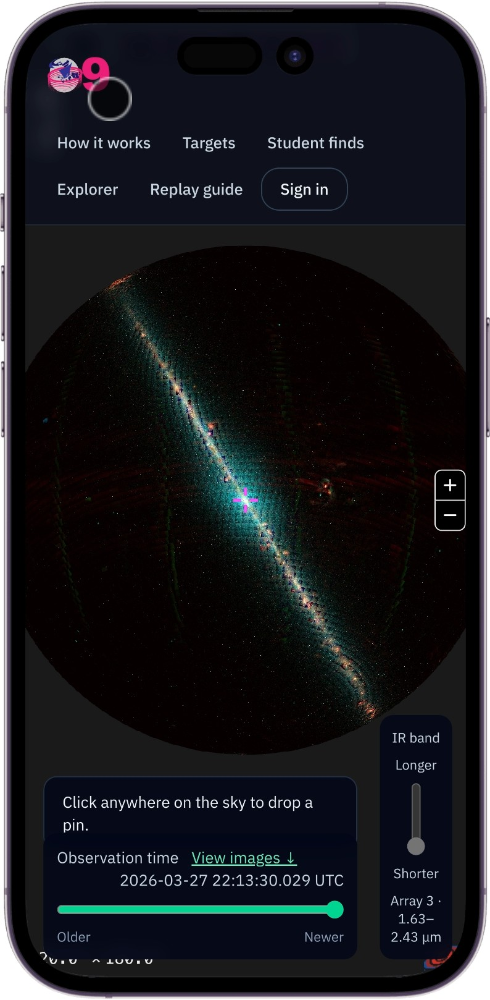

# Planet X — SPHEREx Explorer

Interactive viewer for NASA/IPAC IRSA SPHEREx sky data.


## Screenshots
| Home | Exploration View | Sky Map |
| :---: | :---: | :---: |
|  |  |  |

## Run

### Docker (recommended)

Build once (Compose uses the host network for the API build to avoid the PyPI DNS timeout):

```bash
sudo docker compose build
```

Then run:

```bash
sudo docker compose up -d --no-build
```

Web: http://localhost:8080 · API: http://localhost:8000 · docs: http://localhost:8000/docs

### Local dev (no Docker)

```bash
cd backend
cp ../.env.example .env
uv sync
uv run --env-file .env uvicorn app.main:app --reload --port 8000
```

Uses SQLite in `backend/storage/` by default.

If `backend/storage` was created by an earlier `sudo docker` run, take it back once:

```bash
sudo chown -R $(id -u):$(id -g) backend/storage
```

### Frontend dev

```bash
cd frontend
npm ci
npm run dev
```

Vite runs on http://localhost:5173 and proxies API requests to `localhost:8000`.
Set `VITE_API_BASE_URL` to point at a different port.

## API Endpoints

API: http://localhost:8000 · docs: http://localhost:8000/docs

| Path | What it does | Auth |
|---|---|---|
| `GET /health` | liveness | — |
| `GET /targets` | preset sky targets | — |
| `GET /frames?ra&dec&radius` | observation epochs covering a position (cached 24 h) | — |
| `GET /render?url=...` | IRSA SPHEREx FITS → stretched PNG | — |
| `GET /combine?mode=diff\|coadd\|stack&urls=...` | epoch subtraction / stacking / band sums → PNG | — |
| `GET /rgb?r&g&b` | three bands → false-colour composite | — |
| `GET /photometry?ra&dec&urls=...` | aperture medians across band files | — |
| `GET /flags?url=...` | FLAGS bit counts + VARIANCE summary | — |
| `POST /register` | create account `{username, password}` | — |
| `POST /login` | log in, returns 7-day bearer token | — |
| `GET /me` | current account | bearer |
| `POST /logout` | invalidate the token | bearer |
| `GET /discoveries` | claimed planets (public read) | — |
| `POST /discoveries` | claim a discovery `{name, ra, dec}`; first claim within 1″ wins | bearer |

All endpoints are JSON. `POST` bodies are JSON objects; query params on `GET`.
Every IRSA URL parameter is validated against `https://irsa.ipac.caltech.edu/ibe/data/spherex/`.
Rendered PNGs are served at `/storage/png_renders/{sha1}.png`.

## License
Orbit9 is under the MIT License
